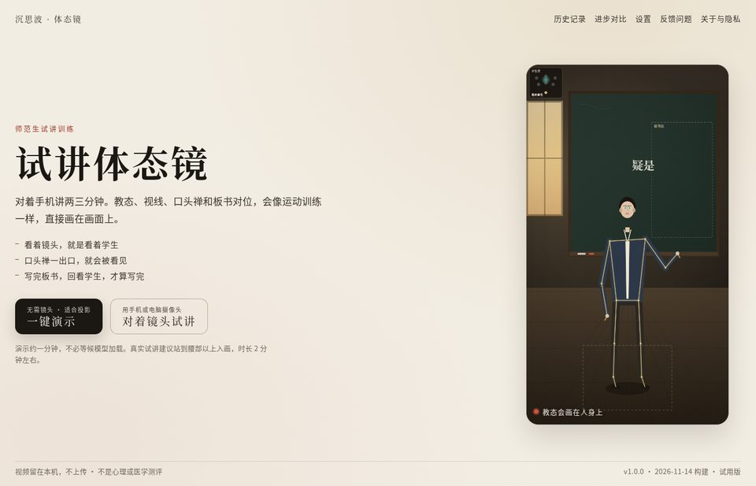

<p align="center">
  
</p>

<h1 align="center">OpenPodium · 开讲</h1>

<p align="center">
  <strong>先讲出来，再看清楚。</strong><br>
  一面给试讲与表达练习用的镜子：讲一段，回看一个具体时刻，找到下一次能改的一处。
</p>

<p align="center">
  <a href="LICENSE"></a>
  &nbsp;
  <a href="https://github.com/chensibo2049/titaojing/actions/workflows/ci.yml"></a>
</p>

<p align="center">
  <a href="https://openpodium.chensibo.cn/landing/">产品介绍</a> ·
  <a href="https://openpodium.chensibo.cn/">开始练习</a> ·
  <a href="https://openpodium.chensibo.cn/#/demo">预设演示</a> ·
  <a href="https://github.com/chensibo2049/titaojing/issues">反馈问题</a>
</p>

<p align="center">
  
</p>

> 2026-11-17 文档口径：本轮以远端 `7b9f12e` / package **1.6.4** 为基线，目标版本 **1.7.0**；目标不等于已发布。实际源码版本看 `package.json`，线上版本看对应站点的 `version.json`，两者不能互相代替。

**主力站**是 [openpodium.chensibo.cn](https://openpodium.chensibo.cn/)。[GitHub Pages](https://chensibo2049.github.io/titaojing/) 只保留兼容入口，不等于主站。主站采用手动白名单制品发布，不随 main 或 Pages 成功自动切换；见 [部署指南](docs/DEPLOY.md)。换域名不会自动迁移浏览器历史与听写缓存。

## 为什么做这面镜子

我们从试讲与表达练习出发，把动作、面向估计与语言线索留在时间线上，方便练习者自己回看，而不是用一个分数替人下结论。项目从「体态镜」更名为 OpenPodium · 开讲，由[沉思波团队](https://chensibo.cn)发起、开放共建；不是独立产品 kaijiang.chensibo.cn。

## 给谁用

- **师范生、教师与教资面试练习者**：讲两分钟，回看一个时刻，再练同一处。
- **表达与演讲练习者**：用于路演、课堂发言等个人练习；不代表各场景评价规则都已成熟。
- 以电脑端为主；手机权限、性能和浏览器兼容性需要按设备验证，不承诺所有机型可用。

## 当前能做什么

| 能力 | 范围与限制 |
|---|---|
| 真实练习 | 摄像头画面经本机 MediaPipe 处理，提供姿态、面向与可选手部线索；真实练习不加载 three.js。练习 1–5 分钟（默认 2 分钟），课堂 10 / 15 / 20 分钟，硬上限 22 分钟。 |
| 回放与报告 | 事件时间线、可用时的转写与口头禅标记、本机历史、对比与导出。未听写不等于口头禅零次；识别和时间对齐仍需真人验证。 |
| 手与板书 | 估计板书区动作与回视，保留板书区静帧供自查；不能识别黑板文字，也不是精确眼动追踪。 |
| 语文试讲观察表 | 从可用转写定位原话和时刻，无法判断的内容留给自查。观测与场景解释尚未完全解耦，不是客观教学评分。见 [说明](docs/YUWEN_RUBRIC.md)。 |
| 本地视频导入 | 只做视觉分析与当前回放；不听音轨、不转写、不统计口头禅、不写入历史。 |
| 预设演示 | 演示与演示回放按需懒加载轻量 Three 渲染，失败可降为 2D。人物是动画 rig 投影，骨架、字幕、事件和点评均为预设，不是真人识别、ASR 或效果证据。提前结束仍展示完整预设样本，不代表已观看片段的识别结果。 |
| 模拟课堂／路演 | 默认关闭，采用 2D 插画与文字、本机规则互动；不是联网智能体、真人学生或真实观众反馈。见 [规则](docs/SIM_CLASS.md)、[人物来源](docs/CHARACTERS.md)。 |
| 本机记录 | 历史存在当前浏览器，录像默认不保存；勾选后只存本机。可删除和导出，没有云同步。 |

<p align="center">
  
</p>

> 这些是实现范围，不是效果测评。单镜头估计只供练习自查，不用于考试评分、心理诊断或教学质量认证。没有可公开核验的用户规模、收入、学校采纳或改善效果证据，不以 demo 或 CI 成绩替代。

### 模型与隐私

- **视觉**：首次需下载 MediaPipe 模型与 WASM；推理在本机，不上传视频。资源缓存就绪前不能承诺离线。
- **本机听写**：已接入 sherpa-onnx WASM + 中文 Paraformer int8，不是占位。引擎与模型合计约 **90 MiB**，新用户默认不自动下载；可主动下载或开启自动下载，旧设置中显式开启的值保留。资源缓存齐全且浏览器兼容时可本机离线识别，不上传声音。
- **浏览器听写（Web Speech）**：可能把声音传给浏览器／系统厂商，在中国大陆也可能连不上。自动模式本机就绪时优先本机，否则尝试浏览器听写；仅本机模式未就绪时不偷偷切到在线。
- **服务器 ASR**：provider 正在实施，公网接通与上线尚未确认，暂按**未上线**说明。托管模型下载文件不等于服务器执行推理。

详见 [ASR 说明](docs/ASR.md)、[隐私说明](docs/PRIVACY.md)。旧技术 ID（如 `titaojing-*`）、仓库与兼容路径保留，避免破坏既有记录和缓存，不代表产品未更名。

## 本地开始

需要 Node.js / npm、Python 3，以及支持摄像头的现代浏览器（建议 Chrome / Edge）。

```bash
npm install
./start.sh           # macOS / Linux；Windows 用 start.bat
```

终端会打印实际网址，默认 [http://127.0.0.1:8765/](http://127.0.0.1:8765/)；端口占用时顺延，也可 `./start.sh 9000`。不要双击 `index.html`，摄像头需要 HTTPS 或 localhost 安全上下文。

手机权限与摆放见 [摄像头排错](docs/CAMERA_DEBUG.md)、[课堂说明](docs/CLASSROOM.md)；首次完整练习可照着 [练习单](docs/PRACTICE.md) 走。排错可加 `?debug=1`，分享前注意文本和轨迹中的隐私。

## 能力与规划分开

当前是浏览器静态练习工具，**没有已上线的团队账号、安全收费授权、业务管理后台或插件 SDK／市场**。前端 trial/pro 开关不是安全收费系统；桌面与移动外壳只有脚手架，不等于已发布安装包。

下一步优先统一来源与缺失语义、采集获授权的真实练习闭环、验证真机和报告证据。可选服务器转写、Core／场景解释进一步分离、多端发行和团队能力均需单独验收，不预先承诺交付日期。见 [路线图](docs/ROADMAP.md)。

## 历史与开源

2026-11-16：v1.6.2 移除装饰性 3D；v1.6.3 恢复**仅 demo 懒加载**的轻量 Three；v1.6.4 修复演示结束与来源说明。旧截图和测试记录只说明当时范围，不能当作本轮实测。完整历史见 [CHANGELOG](CHANGELOG.md)、[轻量演示验收记录](docs/轻量3D演示验收-20261116.md)、[结束补丁记录](docs/演示结束补丁发布-20261116.md)。当前制品许可须覆盖实际使用的 Three、MediaPipe、ASR 等组件，见 [NOTICE](NOTICE)；不因 demo 恢复而恢复旧 Rocketbox／Draco 宣传资源。

[Apache License 2.0](LICENSE)。可在保留声明的前提下使用、修改和再分发；品牌「沉思波」「开讲」「OpenPodium」不随许可证授予商标权。

参与前请阅读 [贡献指南](CONTRIBUTING.md)、[行为准则](CODE_OF_CONDUCT.md) 和 [安全说明](docs/SECURITY.md)。主仓库在 GitHub，国内镜像与托管比较见 [仓库托管说明](docs/REPO_HOSTING.md)。

---

**English.** OpenPodium (开讲, formerly 体态镜) is an open-source practice mirror for teaching and speaking. Visual inference and history stay in the browser; optional Web Speech may send audio to browser vendors. Local Chinese ASR is implemented and requires an explicit model download by default. The lazy-loaded animated demo uses preset rigs and subtitles, not real recognition. Server ASR is not confirmed live. Licensed under Apache 2.0.
