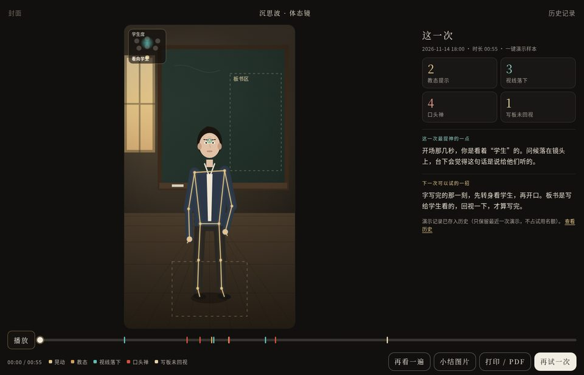

<p align="center">
  
</p>

<h1 align="center">体态镜 · OpenPodium</h1>

<p align="center">
  <strong>一面给试讲用的镜子</strong><br>
  把电脑放在讲台或课桌上，对着镜头讲一段课。<br>
  教态、视线和口头禅会直接画在画面上，讲完即可回看。
</p>

<p align="center">
  <a href="LICENSE"></a>
  &nbsp;
  <a href="https://github.com/chensibo2049/titaojing/actions/workflows/ci.yml"></a>
  &nbsp;
  
</p>

<p align="center">
  <a href="https://chensibo2049.github.io/titaojing/landing/">产品介绍</a>
  &nbsp;·&nbsp;
  <a href="https://chensibo2049.github.io/titaojing/">在线打开</a>
  &nbsp;·&nbsp;
  <a href="https://github.com/chensibo2049/titaojing/issues">反馈问题</a>
</p>

<p align="center">
  
</p>

## 为什么做这面镜子

最近在路演和表达上，我总觉得差点意思。去参加职业规划赛，才发现台上的人都很专业。那段时间和我的对象一起「以赛促学」，专门练表达。练着练着，就做出了这面给试讲用的镜子，想开源出来，和大家一起用、一起改。

由[南京市沉思波网络科技有限责任公司](https://chensibo.cn)发起。作者同时是江苏第二师范学院汉语言文学师范专业的学生。产品里不使用大学校徽。

## 给谁用

- **教师面试、试讲**：把一段课讲完，再自己看教态、视线和口头禅。
- **教师资格证面试**：练习模式几分钟就能反复练同一处。
- **表达与演讲**：路演、职规赛、课堂发言，凡是需要把一段话讲清楚的场合，都可以对着镜子练。

我们会**重点打磨电脑端**：电脑放在讲台或课桌上就能练，不必再找手机支架。手机同样可以用，只是长期练习时，电脑更方便。

## 你能看见什么

<p align="center">
  
</p>

|  |  |
|---|---|
| **一键演示** | 不用打开摄像头，大约一分钟看完叠加、回放和水词，适合投影介绍。 |
| **练习或课堂** | 练习 1–5 分钟（默认 2 分钟）；课堂 10 / 15 / 20 分钟，最长 22 分钟。 |
| **半身或全身** | 讲台近景看视线和肩线；再远一些能看见站位、步伐，以及写板时会不会背对学生。可指定，也可自动判断。 |
| **回放与转写** | 时间线上有标记，转写里的水词会标出，并给出具体改法。点某一句就能跳到那里。 |
| **手与板书** | 能看见双手，判断是否伸向板书区、是否在写、写完是否回视。**目前不能认出黑板上的字**；写板时会留下板书区静帧，供你自己看字迹。 |
| **观察记录与语文试讲观察表** | 回放页按评课表列出语气词、停顿、语速、站位、提问等，只摆事实，不做好坏评分。语文试讲另有一张观察表：能从转写里定位的给出原话和时刻，看不出的用自查清单；方法提示来自师范生备考笔记。开讲页可把题干 2–3 条粘进去，用来对照「紧扣题干」。说明与打印稿见 [`docs/YUWEN_RUBRIC.md`](docs/YUWEN_RUBRIC.md)。 |
| **模拟课堂（练习用）** | 默认关闭。打开后，画面旁会出现几位虚拟同学或路演嘉宾，按你的话举手、回答或提问，用来练点名、追问和应对提问。说「齐读」会全班齐读，说「请你来读」会有一位同学站起来读。全部在本机演算，不联网。题库是一份可编辑的 JSON，见 [`docs/SIM_CLASS.md`](docs/SIM_CLASS.md)。 |
| **历史留在本机** | 可以和上一次对比，也可以导出小结图片、PDF 或 JSON。视频默认不上传，只保存在这台设备的浏览器里。 |

<p align="center">
  
</p>

> 画面来自单个摄像头的估计，只作训练提示，不是精确测量，也不是心理或医学评估。

## 三步开始

需要 Python 3，以及 Chrome 或 Edge。

```bash
npm install          # 首次；国内可先 npm config set registry https://registry.npmmirror.com
./start.sh           # macOS / Linux。Windows 用 start.bat
```

终端会打印实际网址（默认 [http://127.0.0.1:8765/](http://127.0.0.1:8765/)）。若 8765 已被占用，会自动改用后面的空闲端口，请打开终端里的那一行。也可 `./start.sh 9000`。

也可以先打开[在线介绍页](https://chensibo2049.github.io/titaojing/landing/)，或直接[在浏览器里试用](https://chensibo2049.github.io/titaojing/)（必须是 https，才能调用摄像头）。

不要双击 `index.html`（`file://` 下不能用镜头）。手机测试与课堂摆放见 [`docs/CAMERA_DEBUG.md`](docs/CAMERA_DEBUG.md)、[`docs/CLASSROOM.md`](docs/CLASSROOM.md)。第一次完整试讲，可以照着 [10 分钟试讲练习单](docs/PRACTICE.md) 来。排错可在网址后加 `?debug=1`。

## 接下来怎么走

- 网页版会持续打磨，现在就可以在浏览器里用。
- 会做便于下载、在本机使用的 Windows / macOS 电脑版（骨架在 [`apps/desktop/`](apps/desktop/)）。
- 本机听写：进入页面后会在后台下载中文听写包（约 90 MB，一次即可，可在设置里关掉），之后在浏览器里离线转写普通话，声音不离开设备，见 [`docs/ASR.md`](docs/ASR.md)。没下载完时用浏览器听写：在中国大陆，Chrome 即使网页能打开，听写也经常连不上厂商服务。
- 欢迎学校、教具和培训机构一起把这面镜子送到更多教室。
- 以后可能会有「像评委一样的课后点评」，现在还没有；先把镜子本身做好。

路线说明见 [`docs/ROADMAP.md`](docs/ROADMAP.md)。使用中的想法，欢迎直接开 [Issue](https://github.com/chensibo2049/titaojing/issues)。

## 开源协议

[Apache License 2.0](LICENSE)。与项目所用的 MediaPipe 许可兼容，也方便后续的商业合作与赞助：其他人可以在保留声明的前提下使用、修改和再分发，专利授权是明确写进协议里的。品牌名「沉思波」「体态镜」「OpenPodium」不随许可证授予商标权。第三方说明见 [`NOTICE`](NOTICE)。

参与前请阅读 [贡献指南](CONTRIBUTING.md)、[行为准则](CODE_OF_CONDUCT.md)、[隐私说明](docs/PRIVACY.md) 和 [安全说明](docs/SECURITY.md)。

主仓库在 GitHub。国内镜像与托管比较见 [`docs/REPO_HOSTING.md`](docs/REPO_HOSTING.md)。

---

**English.** OpenPodium (体态镜, “open podium”: a practice mirror for teaching and speaking) is an open-source, in-browser trainer. Put a laptop on the desk or podium, give a short lesson, and see posture, gaze and filler words drawn on the video. Replay and history stay on the device by default. This is a classroom training tool, not a generic “AI product.” Licensed under Apache 2.0.
