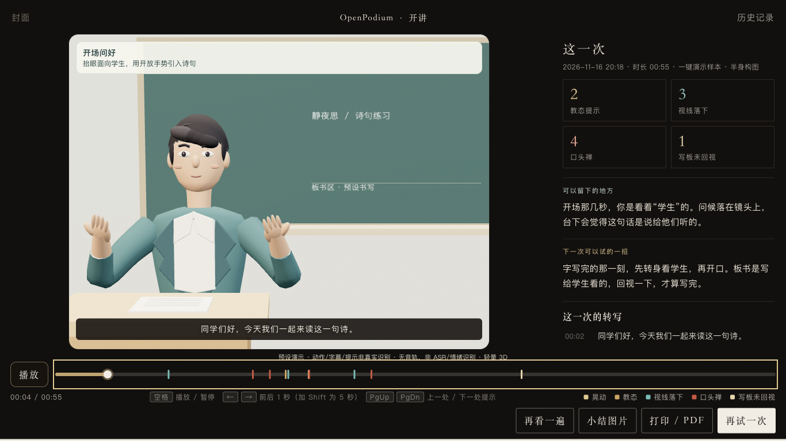
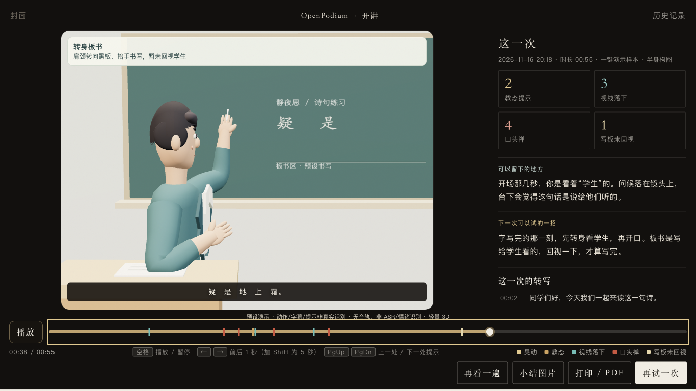
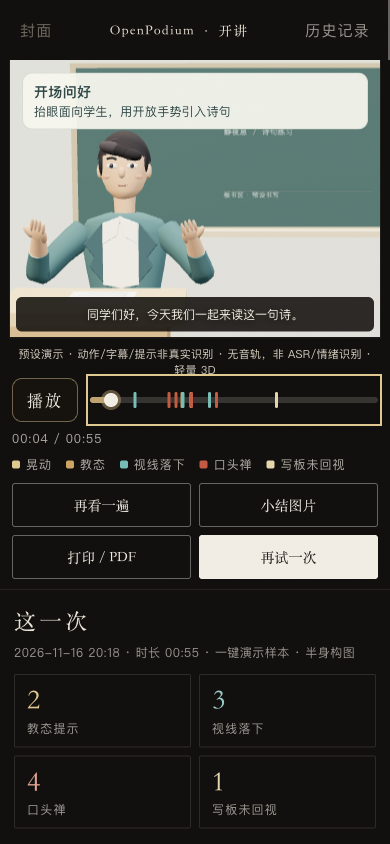
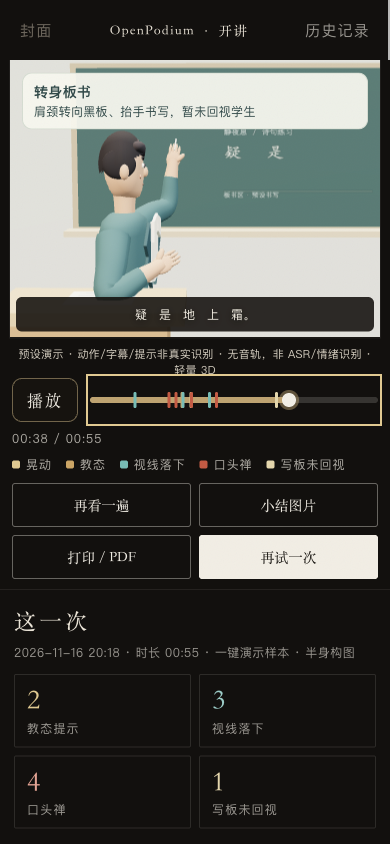

# 轻量 3D 演示 · 实施与验收

## 本轮边界

- 用户 2026-11-16 新要求：仅演示及演示回放恢复 Three.js，替代该路径上一轮去 3D 决定。
- main 基线 `20aa587`，任务分支 `feat/demo-three-1.6.3`；当前目录直接实施，`wt` 不可用。
- 保护 `.gitignore`、`bun.lock`、未跟踪脚本与实拍/私人素材，不 stash、不加入本轮提交。
- 有并行 PR #7（翻页笔）；不改其代码，不恢复 Rocketbox/Draco、旧宣传片，不改真实相机/视频识别路径。
- 可改范围：演示 rig/时间轴/惰性加载、main 演示生命周期、构建白名单、package.json/package-lock.json（本会话持有）、演示/双端专项测试及本轮文档。不改 deploy 配置。

## 最小版本方案

- 原创程序化风格化试讲者：连续衣服轮廓、定制头发/五官、弯曲手臂和手掌手指；柔和明亮课堂、近景讲台和可辨板书。
- 同一个绝对时间驱动动作、板书、字幕与阶段说明；无独立动画时钟，不冒充 ASR/情绪识别。
- Three 单独制品，仅进入演示才 import；2D 加载中占位与失败降级。骨架默认不显示，不叠旧 2D 骨架。
- 验收标准更新为：非演示无 3D 请求、无旧重型资产、演示懒加载；完整保留 MediaPipe 推理/模型断言。

## 本地验收结果

构建 `1.6.3-2e7ba588`；40 个公开文件，约 51.3 MB。没有恢复 Rocketbox、Draco、GLB 或旧宣传媒体。

| 检查 | 实际结果 |
|---|---|
| `node scripts/检查演示时间轴.mjs` | 14 项通过；阶段、确定性 seek、IK 骨长、低性能/失败回退、异步竞态与释放 |
| `npm run build` | 通过，MediaPipe 资源 SHA-256 校验通过 |
| `npm test` | 全部通过；保留真实视觉模型、口头禅、ASR 和业务规则检查 |
| `npm run check-docs` | 21 个文档，无死链 |
| `node scripts/检查无3D构建.mjs` | 通过：主包零 Three，演示独立自包含 ESM，dist 白名单与真实模型哈希正确 |
| `EGO_SPACE=10 npm run smoke -- --ego` | 50 项通过（含四尺寸当前版本断言）；实际播放暂停、九个关键时间、反向 seek、模块只加载一次、WebGL 丢失/加载失败回退、退出销毁、旧入口与四尺寸布局 |
| `EGO_SPACE=10 node scripts/检查双端布局.mjs --ego` | 35 项通过（含四尺寸当前版本断言）；1366×768、390×844、360×800、844×390，封面/设置/关于/介绍页/练习准备/演示回放无横向溢出 |

`--ego` 复用当前 Ego TaskSpace，不启动第二套浏览器；它是专项替代路径，不等于原 headless 摄像头 smoke 的全覆盖。原 CI 摄像头 smoke 保留，须以实际 CI 结果另行确认。

### 实际视觉审查与修复

- 已实际读取用户指定的旧图：`演示3D-1366-宽幅开场.png`、`演示3D-390-开场.png`、`演示3D-390-板书.png`。旧桌面图存在露头皮，旧移动板书偏淡；不能用旧图代替当前制品验收。
- 本轮重建后实际读取桌面 4/13/38 秒以及手机开场/板书截图。发现刘海遮眼、缩短发帽后侧面断缝；最终使用前高后低的连续发帽，正面不挡眼，侧面覆盖鬓发。只改原人物几何，没有重写演示。
- 最终桌面开场为抬眼与开放双手，13 秒低头双手靠近讲稿，38 秒肩颈转向板书并抬手。板书随时间显现；桌面“疑 是”清楚，手机可辨但较小。人物是风格化程序模型，不宣称写实人物或真实识别。
- 最终证据保留在下列公开图片；更完整本机截图在 `.smoke-out/轻量演示-最终验收/`，不上传私人截图。

### 遇到的失败

- 第一轮 Ego 指针点击暂停未生效，且视口回到原窗口尺寸；改为真实焦点键盘 Enter 激活并等待按钮状态，不直接调用业务内部函数。之后实际播放推进、暂停后时间与渲染帧稳定。
- 扩展旧入口检查时，844×390 首次在路由异步切换前断言失败；补充等待准备页可见后，四种尺寸均通过。
- PR #8 首轮 CI（run `43865737202`）未通过：关于页仍展示 v1.6.2，能力与设置说明仍称演示全为 2D。已同步应用内 v1.6.3 更新说明、历史记录边界及当前能力文案，并在四种尺寸补充关于页当前版本与轻量演示断言。
- Ego 子进程在重定向时曾未返回 console 输出，不能只凭退出码推断通过；专项脚本增加完整逐项 `result.json`，父进程校验检查数量和每项结果，缺少报告即失败。
- 以上失败没有当作成功；修正后完整重跑。

### 性能记录与边界

桌面样本：DPR 1、73 draw calls、53,288 三角形，挂载约 18.9 ms，平均 render 提交约 0.35 ms。这只是 Chromium 模拟中的 CPU 提交测量，不是 GPU 全帧耗时或实体手机 FPS。

- 未实测实体手机、真实摄像头/麦克风授权、真实人物推理、音频录制及 ASR。
- 暂停/seek 确定性和失败回退已验收；没有把预设字幕当作 ASR 或情绪识别结果。
- 本轮不修改 nginx、证书、课件站或自动部署配置；私人素材、`.gitignore`、`bun.lock`、并行 PR #7 不纳入提交。

## 源码与主力站发布

本地门禁已通过；源码 PR/CI 与 quan2 原子切换、公网版本及新模块验收分别记录，不能用 Pages 成功替代主力站。
